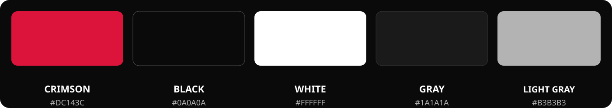

# DylanOS Crimson 1.0

<p align="center">
	
</p>

<p align="center">
	<strong>Un escritorio Linux con identidad propia.</strong><br>
	Debian 13 · KDE Plasma 6 · Qt 6 · DylanOS Crimson
</p>

<p align="center">
	<a href="docs/install.md">Instalación</a> ·
	<a href="docs/build-hosts.md">Hosts de compilación</a> ·
	<a href="MAINTAINERS.txt">Mantenedores</a> ·
	<a href="docs/architecture.md">Arquitectura</a> ·
	<a href="docs/roadmap.md">Roadmap</a> ·
	<a href="CONTRIBUTING.md">Contribuir</a>
</p>

<p align="center">
	
</p>

> [!NOTE]
> Las imágenes de `previews/` muestran el objetivo visual del proyecto. Pueden incluir diseños en progreso y no representan por sí solas funciones verificadas en una ISO.

## La experiencia Crimson

DylanOS combina la base de Debian con KDE Plasma y una capa visual propia. El rojo carmesí identifica acciones y detalles; los fondos negros y grises dan profundidad, mientras el blanco y el gris claro mantienen la interfaz legible.

<p align="center">
	
	
</p>

## Aplicaciones DylanOS

El proyecto reúne aplicaciones y herramientas propias alrededor de tareas cotidianas del escritorio:

- **Workspace**: bienvenida, archivos, notas, desarrollo, monitor y ajustes.
- **DylanOS Explorer**: gestor de archivos nativo basado en KIO.
- **DylanOS Store**: catálogo, instalación y actualización de software.
- **App Center**: acceso a las aplicaciones instaladas.
- **Spotlight**: búsqueda rápida.
- **Calculator**: calculadora de escritorio Qt.

<p align="center">
	
	
</p>

Las capturas son referencias del aspecto visual de estas experiencias. Para conocer su estado actual, consulta el código de cada aplicación y la [guía de arquitectura](docs/architecture.md).

## Paleta oficial

La paleta se mantiene en [`branding/colors/dylanos.conf`](branding/colors/dylanos.conf) y guía los recursos gráficos del sistema.

<p align="center">
	
</p>

| Color | HEX | Aplicación |
|---|---|---|
| DylanOS Crimson | `#DC143C` | Acentos, acciones e identidad |
| DylanOS Black | `#0A0A0A` | Fondos profundos |
| DylanOS White | `#FFFFFF` | Texto y contraste |
| DylanOS Gray | `#1A1A1A` | Paneles y superficies |
| DylanOS Light Gray | `#B3B3B3` | Texto secundario y detalles |

## Componentes del sistema

| Ruta | Propósito |
|---|---|
| `apps/` | Aplicaciones de DylanOS |
| `branding/` | Logo, colores, iconos y fondos |
| `configs/` | Ajustes del sistema y del entorno de usuario |
| `installer/` | Componentes del instalador |
| `packages/` | Selección de paquetes del sistema |
| `scripts/` | Construcción, staging y comprobaciones |
| `themes/` | Temas de Plasma, SDDM, GRUB, GTK y Plymouth |
| `previews/` | Capturas y referencias del diseño objetivo |

## Construir y probar

Desde la raíz del repositorio ejecuta `bash init.sh`. Detecta el sistema: en Debian/Ubuntu amd64 instala dependencias nativas y prepara `.venv`; en otras distribuciones Linux amd64 usa Docker. Si falta Docker o Compose, intenta instalarlos y arrancar el servicio automáticamente en Arch, Fedora/RHEL, openSUSE y Alpine; en otras distribuciones Docker debe estar instalado. Consulta la [matriz de hosts de compilación](docs/build-hosts.md) para conocer los requisitos. Antes de instalar paquetes, iniciar el daemon o construir la imagen, muestra lo que hará y pide confirmación. Si respondes que no, no hace cambios.

```bash
bash init.sh
```

Después de preparar las dependencias nativas en Debian/Ubuntu, ejecuta:

```bash
make check PYTHON=.venv/bin/python
make build
make iso
make test-iso
```

`make` sin argumentos muestra la ayuda. `make build PROFILE=minimal` construye el perfil base; el perfil predeterminado es `development`. Para continuar un chroot existente usa `make build RESUME=1`. `make qemu-test` ejecuta la prueba de arranque en QEMU sobre una ISO ya creada. También puedes invocar los scripts de `scripts/` directamente.

### Construir con Docker

También puedes usar el entorno de construcción incluido. Requiere Docker Engine y Compose v2 en un host Linux amd64, además de al menos 25 GB libres. El contenedor del builder usa modo privilegiado para permitir los namespaces y montajes del chroot; ejecútalo solo con código de confianza.

```bash
docker compose build builder
docker compose run --rm builder make check
docker compose run --rm builder make build
docker compose run --rm builder make iso test-iso
```

Para el perfil base usa `docker compose run --rm builder make build PROFILE=minimal`; para continuar un chroot existente, agrega `RESUME=1`. La ISO queda en la raíz del repositorio. Los archivos generados pueden quedar propiedad de `root`. Si tu usuario no tiene acceso al daemon, antepone `sudo` a los comandos `docker compose`. La prueba gráfica de QEMU se ejecuta en el host, con QEMU instalado, usando `make qemu-test`.

Para la configuración de desarrollo, los criterios de prueba y las precauciones antes de instalar, sigue la [guía de instalación y QA](docs/install.md). Una prueba automatizada correcta no sustituye la validación de arranque e instalación en una máquina virtual.

## Documentación

- [Instalación y QA](docs/install.md)
- [Optimización del sistema e ISO](docs/optimization.md)
- [Optimización de paquetes e ISO](docs/optimization.md)
- [Arquitectura](docs/architecture.md)
- [Roadmap](docs/roadmap.md)
- [Branding](branding/README.md)
- [Licencias de recursos](docs/licenses/assets.md)
- [Índice de documentación](docs/README.md)
- [Contribuir](CONTRIBUTING.md)

Los informes y auditorías fechados en `docs/` se conservan como contexto histórico; consulta las guías anteriores para el estado vigente.

## Contribuir

Las contribuciones son bienvenidas. Lee [`CONTRIBUTING.md`](CONTRIBUTING.md), mantén los cambios enfocados y describe las pruebas realizadas.

## Licencia

El código de DylanOS se distribuye bajo la [GNU General Public License v3.0 o posterior](LICENSE), salvo que un archivo o recurso indique expresamente otra licencia.
